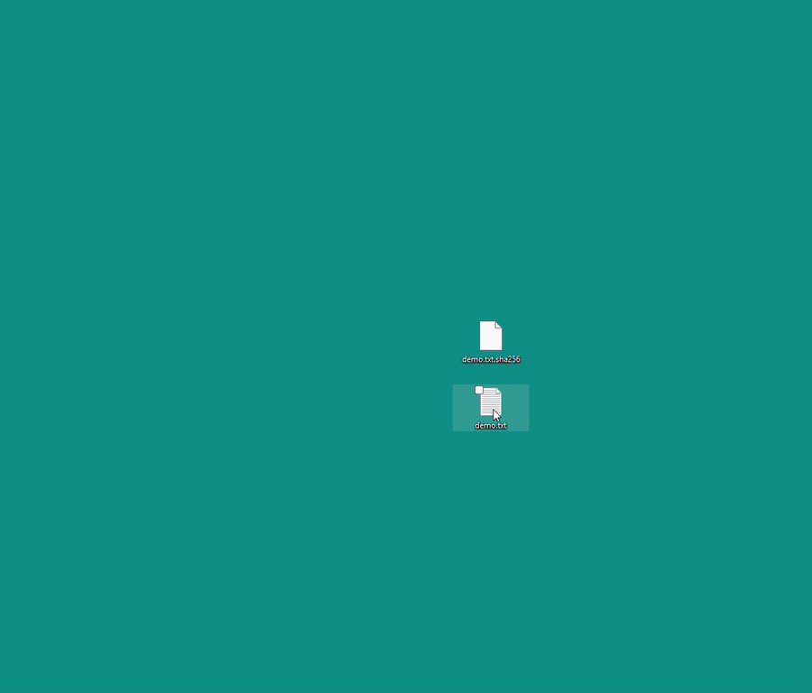
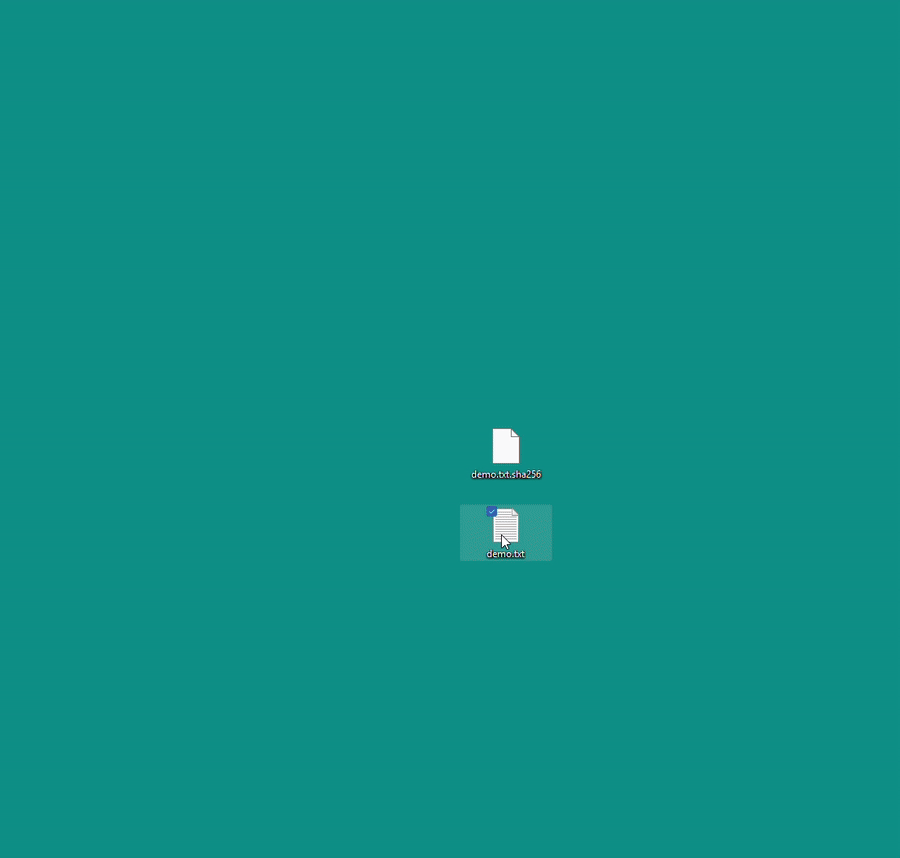

# ChecksumVerify

> Verify file checksums from the Windows right-click context menu — no terminal, no copy-pasting, one click.

[](https://github.com/hluxenhofer/checksum-verify/actions/workflows/build.yml)
[](https://github.com/hluxenhofer/checksum-verify/releases/latest)

[](https://github.com/hluxenhofer/checksum-verify/actions/workflows/codeql.yml)
[](https://scorecard.dev/viewer/?uri=github.com/hluxenhofer/checksum-verify)
[](LICENSE)

Right-click any file → **Show more options** → **Verify Checksum**

---

<p align="center">
  
</p>

---

## Install

**Download the installer:**

Go to [Releases](../../releases/latest) and run `ChecksumVerify-x.y.z-Setup.exe`.

The installer registers the context menu entry for all users (administrator rights required) and includes a clean uninstaller (`Settings → Apps`).

> **winget:** coming soon.

### Unsigned installer notice

The installer is currently **not code-signed**, so Windows SmartScreen may show "Windows protected your PC". Click **More info → Run anyway** only after verifying the download (below). Code signing via [SignPath Foundation](https://signpath.org/) is planned.

### Verify your download

Every release includes a `SHA256SUMS` file. Compare it with the installer's hash:

```powershell
(Get-FileHash .\ChecksumVerify-x.y.z-Setup.exe -Algorithm SHA256).Hash
```

Release installers also carry a signed [build provenance attestation](https://docs.github.com/en/actions/security-for-github-actions/using-artifact-attestations/using-artifact-attestations-to-establish-provenance-for-builds) proving they were built by this repository's release workflow:

```powershell
gh attestation verify .\ChecksumVerify-x.y.z-Setup.exe --repo hluxenhofer/checksum-verify
```

### Uninstall

`Settings → Apps → Installed apps → ChecksumVerify → Uninstall`. This removes the application files and the context menu entry.

### Privacy

No network access, no telemetry, no background process. Files are only read locally to compute hashes.

---

## Features

- **Right-click any file** — "Verify Checksum" appears in the extended context menu (Show more options on Windows 11)
- **Paste a hash or point to a hash file** — typed/pasted hash, sidecar files (`.sha256`, `.b3`, …), or GNU coreutils format
- **Clipboard auto-fill** — if you copied a hash before right-clicking, the popup pre-fills it and selects the algorithm automatically; `algo:hex` prefixed hashes (e.g. `sha256:5906b1…`) are also recognized
- **9 algorithms** — SHA-256, SHA-512, SHA3-256, SHA3-512, BLAKE3, BLAKE2b-256, BLAKE2b-512, MD5, SHA-1
- **Streaming computation** — reads in 64 KB chunks; multi-GB files never spike memory
- **In-window result banner** — ✓ match or ✗ mismatch shown directly in the popup; on failure the computed hash is displayed, highlighted, and copied to clipboard
- **Zero idle footprint** — no background process, no tray icon, no startup entry; the process launches on demand and exits when the window is closed

---

## Hash File Demo

Instead of pasting, pick a `.sha256`, `.b3`, … sidecar or a GNU coreutils checksum list; the algorithm is selected automatically.

<p align="center">
  
</p>

---

## Requirements

| Requirement | Minimum |
|---|---|
| Windows | Windows 10 22H2 or Windows 11 |
| SHA3 algorithms | Windows 11 22H2+ only (CNG requirement) |
| Architecture | x64 (ARM64 builds are not published yet) |

SHA3-256 and SHA3-512 options are automatically grayed out with an explanatory tooltip on Windows 10.

---

## Supported Algorithms

| Algorithm | Hex length | Notes |
|---|---|---|
| SHA-256 | 64 chars | Default; auto-detected from clipboard |
| SHA-512 | 128 chars | Auto-detected from clipboard |
| SHA3-256 | 64 chars | Windows 11 22H2+ only |
| SHA3-512 | 128 chars | Windows 11 22H2+ only |
| BLAKE3 | 64 chars | |
| BLAKE2b-256 | 64 chars | |
| BLAKE2b-512 | 128 chars | |
| MD5 | 32 chars | Legacy; auto-detected |
| SHA-1 | 40 chars | Legacy; auto-detected |

When clipboard content is ambiguous (e.g., 64 hex chars could be SHA-256, SHA3-256, BLAKE3, or BLAKE2b-256), the dropdown defaults to SHA-256 and shows a disambiguation note.

---

## Hash File Formats

**GNU coreutils** (`sha256sum`, `sha512sum` output):
```
2cf24dba5fb0a30e26e83b2ac5b9e29e1b161e5c1fa7425e73043362938b9824  hello.bin
e3b0c44298fc1c149afbf4c8996fb92427ae41e4649b934ca495991b7852b855 *empty.bin
```

**Sidecar files** — ChecksumVerify auto-selects the algorithm from the extension:

| Extension | Algorithm |
|---|---|
| `.sha256` | SHA-256 |
| `.sha512` | SHA-512 |
| `.sha3-256` | SHA3-256 |
| `.sha3-512` | SHA3-512 |
| `.b2`, `.blake2`, `.blake2b` | BLAKE2b |
| `.b3`, `.blake3` | BLAKE3 |
| `.md5` | MD5 |
| `.sha1` | SHA-1 |
| `.sha256sum`, `.sha512sum` | SHA-256 / SHA-512 (GNU coreutils list) |

---

## Troubleshooting

- **No "Verify Checksum" entry on Windows 11** — it lives under **Show more options** (or press `Shift+F10`) in the classic context menu.
- **SmartScreen warning** — see [Unsigned installer notice](#unsigned-installer-notice).
- **SHA3 options are grayed out** — SHA3 needs Windows 11 22H2+ (see [Requirements](#requirements)).
- **Anything else** — [open an issue](https://github.com/hluxenhofer/checksum-verify/issues/new/choose) or see [SUPPORT.md](SUPPORT.md).

---

## Building from Source

**Prerequisites:** .NET 10 SDK

```powershell
# One-time setup
.\dev-setup.ps1

# Build
dotnet build

# Run with a file (opens the verification popup)
dotnet run --project src/ChecksumVerify -- "C:\path\to\file.zip"

# Tests
dotnet test

# Build installer (requires Inno Setup 7)
iscc installer\setup.iss
```

See [CONTRIBUTING.md](CONTRIBUTING.md) for project layout and design principles.

---

## Contributing

Bug reports and feature requests are welcome — please use the issue templates. See [CONTRIBUTING.md](CONTRIBUTING.md) for setup, pull request rules, and design principles. Participation is governed by the [Code of Conduct](CODE_OF_CONDUCT.md).

Security issues: see [SECURITY.md](SECURITY.md).

---

## Changelog

See [CHANGELOG.md](CHANGELOG.md).

---

## License

MIT — see [LICENSE](LICENSE). Third-party components: [THIRD-PARTY-NOTICES.md](THIRD-PARTY-NOTICES.md).
